# CloudCart: A Cloud Capstone Project

A full-stack, event-driven storefront deployed on AWS as a CloudFormation
stack. CloudCart demonstrates the core patterns of a production-shaped
architecture — private networking, least-privilege IAM, JWT-based auth,
managed databases and file storage, and event-driven serverless — at a
scale that fits inside a single lab account.

---

## What it does

- **Storefront** : a PHP product catalog served through an Application Load Balancer, with cart, checkout, and admin product management.
- **Auth** : Cognito User Pools issue JWTs; the PHP app verifies them against Cognito's JWKS and reads `cognito:groups` to gate admin routes.
- **Uploads** : files land in S3, which triggers a Lambda that records the event in RDS and publishes an email via SNS.
- **Data** : a single RDS MySQL instance stores products, customers, carts, orders, and upload records.
- **Code** : the PHP bundle lives in EFS and is delivered from S3 at boot, so any Auto Scaling–launched instance serves the same code without a redeploy.

## Architecture

![[cloudCart.drawio.png]]

Two Availability Zones, three subnet tiers (public / private-app / private-data),
and a single NAT gateway for outbound traffic. S3 is reached through a free
gateway endpoint instead of the NAT, and every internal hop between services
is scoped by security-group-to-security-group rules so no CIDRs, no wildcards.

## Stack at a glance

| Layer | Resources |
|---|---|
| Networking | 1 VPC (`10.20.0.0/24`), 6 subnets across 2 AZs, 1 IGW, 1 NAT gateway, 2 route tables, 1 S3 gateway endpoint |
| Compute | 2 × `t3.micro` EC2 in an Auto Scaling group (min 2 / desired 2 / max 6), 1 Lambda (Python 3.12) |
| Storage | 1 RDS MySQL (`db.t3.micro`), 1 EFS file system, 2 S3 buckets (uploads + deployment artifacts) |
| Edge | 1 internet-facing ALB with sticky-session target group |
| Identity | Cognito User Pool with `admin` / `customer` groups, 2 IAM roles (EC2 and Lambda) |
| Messaging | 1 SNS topic with email subscription |

Everything is defined in a single CloudFormation template and deployed with a
short `deploy.sh` that packages the Lambda and PHP app, uploads them to S3,
and calls `aws cloudformation deploy`.

## If you want to run this 
Don't forget to alter the enviroment variables in the .env.example where you need to put a password for the database and the Email you want to have notifications sent to

Also change the region in deploy.sh

``` bash
cp .env.example .env
# edit .env with your values
source .env
./deploy.sh
```

## How to read this document

The rest of this file is a **deployment flow** which is the project built step by
step in the AWS Console, in the same order a person would click through it.
Each section explains what was created, why it exists, and what to look for
in the accompanying screenshot.

It's written as a walkthrough on purpose: reading it end-to-end tells you how
the system is wired together, not just what resources it contains. If you're
looking for a specific service, use the table of contents:

1. [Networking](#part-1--networking) : VPC, subnets, IGW, NAT, route tables, S3 endpoint
2. [Security groups](#part-2--security-groups) : five SGs, one chain of trust
3. [Storage and data](#part-3--storage-and-data) : S3, EFS, RDS
4. [Identity, messaging, compute](#part-4--identity-messaging-and-compute) : IAM, SNS, Lambda
5. [Load balancing and scaling](#part-5--load-balancing-and-scaling) : ALB, launch template, ASG, EC2
6. [End-to-end request flow](#end-to-end-request-flow) : how a single page load exercises the whole stack

## Repository layout
## Architecture

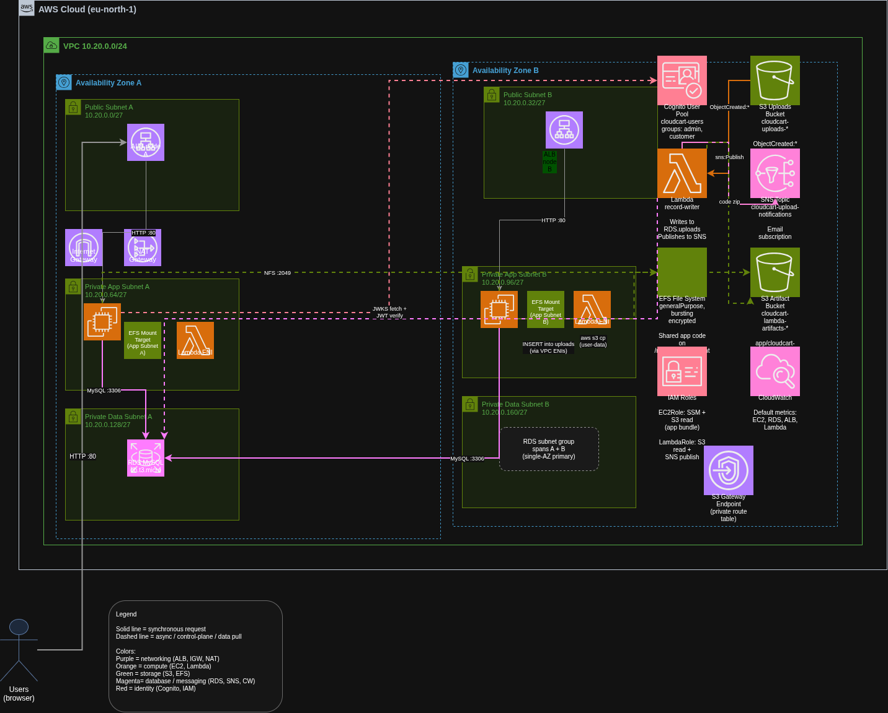

The full design. Traffic enters through the internet-facing ALB, which spreads
requests across two EC2 instances in private subnets. Both instances mount a
shared EFS for the application code and query a single RDS MySQL database.
Uploads to S3 trigger a Lambda that records the event in RDS and publishes a
notification to SNS. Cognito issues the JWTs that the PHP app verifies on
every request.

# 1. Networking

## 1. VPC

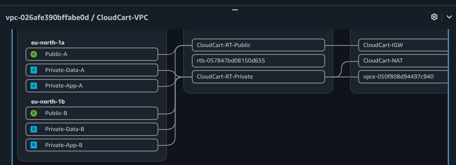

Created `CloudCart-VPC` with CIDR `10.20.0.0/24`. This is the isolated network
boundary that holds every other resource. DNS hostnames and DNS resolution are
enabled so the RDS and EFS endpoints resolve to private IPs inside the VPC.

## 2. Subnets

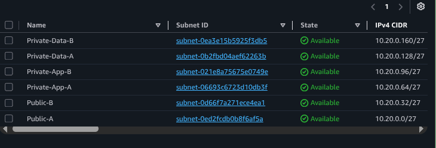

Six subnets across two Availability Zones, forming three tiers:

- **Public-A / Public-B** (`10.20.0.0/27`, `10.20.0.32/27`) — host the ALB and NAT gateway.
- **Private-App-A / Private-App-B** (`10.20.0.64/27`, `10.20.0.96/27`)  host the EC2 application instances, Lambda ENIs, and EFS mount targets.
- **Private-Data-A / Private-Data-B** (`10.20.0.128/27`, `10.20.0.160/27`)  reserved for RDS.

The three tiers exist so each layer has a distinct set of security rules and
routing behavior; the app tier can never be reached directly from the internet.

## 3. Internet Gateway

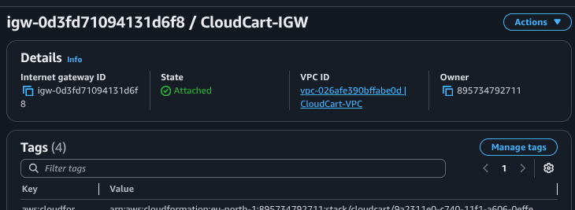

Created `CloudCart-IGW` and attached it to the VPC. The ALB uses it to serve requests, and the NAT gateway uses it to relay outbound traffic from private subnets.

## 4. NAT Gateway

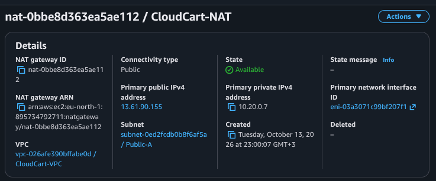

Created `CloudCart-NAT` in **Public-A** with a freshly-allocated Elastic IP.
Private-subnet instances cannot reach the internet directly, so the NAT gateway
becomes their egress path — used for `apt` package installs at bootstrap, JWKS
fetches from Cognito, and SSM Session Manager control-plane connections.

## 5. Route Tables

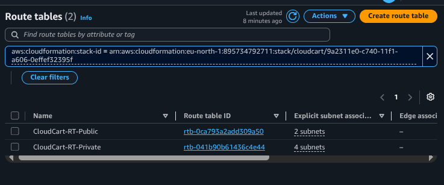
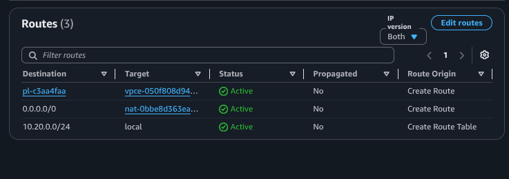

Two route tables:

- **CloudCart-RT-Public**: default route `0.0.0.0/0 → Internet Gateway`, associated with both public subnets.
- **CloudCart-RT-Private**: default route `0.0.0.0/0 → NAT Gateway`, associated with all four private subnets.

The `local` route (VPC-internal) is implicit and lets private subnets reach RDS
and EFS without leaving the VPC.

## 6. S3 Gateway Endpoint

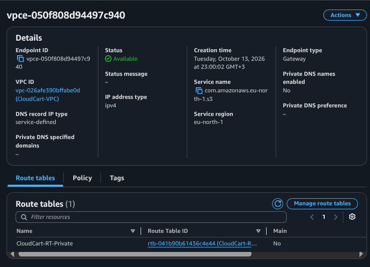

Created a Gateway-type VPC Endpoint for S3 and attached it to the private route
table. This adds a route that sends S3 traffic over the AWS backbone
instead of through the NAT which is free, faster, and the reason the NAT's data bill
stays low even as instances download their bootstrap bundle from S3.

# 2. Security Groups

## 7. Security groups

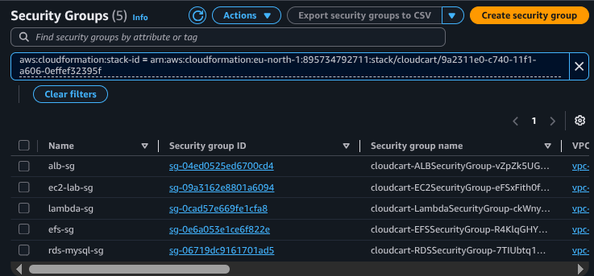
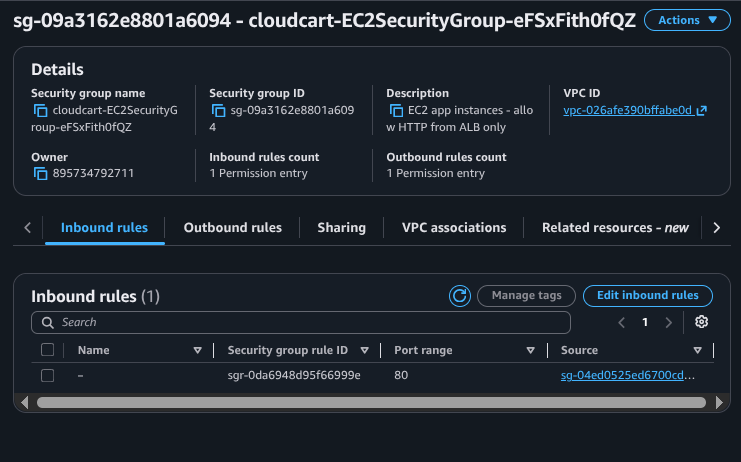
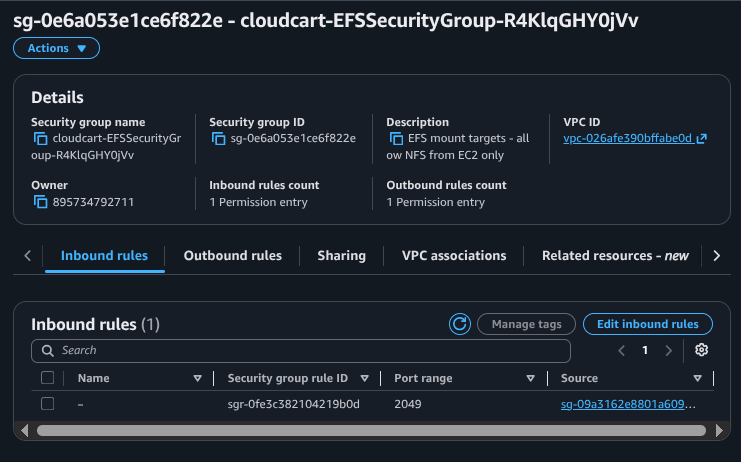
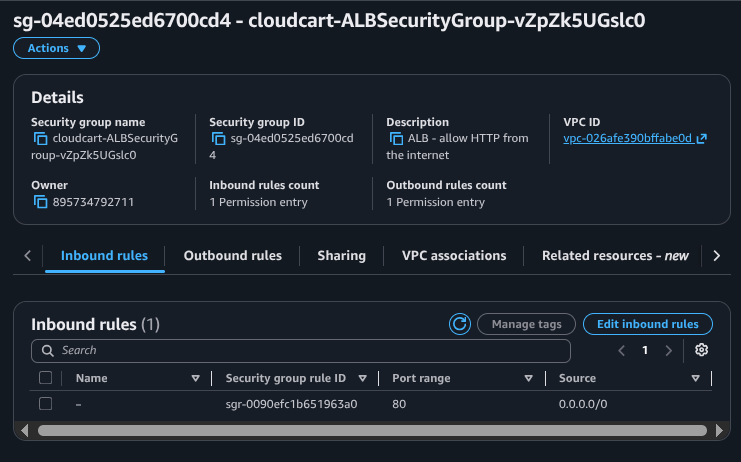
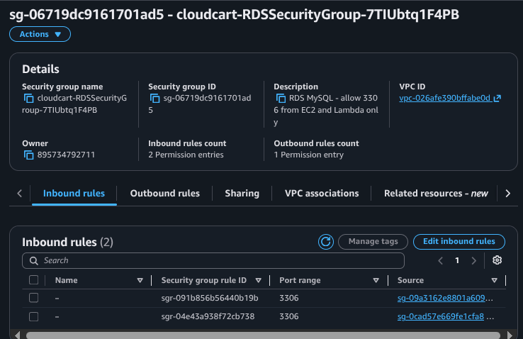

Five security groups that chain together as a chain of trust — each one accepts
traffic only from the specific group that talks to it:

- **alb-sg** : inbound HTTP :80 from `0.0.0.0/0` (the only public entry point).
- **ec2-lab-sg**: inbound HTTP :80 from `alb-sg` only.
- **efs-sg** : inbound NFS :2049 from `ec2-lab-sg` only.
- **lambda-sg** : outbound only; nothing connects to a Lambda ENI.
- **rds-mysql-sg** : inbound MySQL :3306 from `ec2-lab-sg` and `lambda-sg`.

Every rule references a security group, not a CIDR, so the policy survives
instance replacement and can't be accidentally widened by an IP change.

## 8. Cognito users

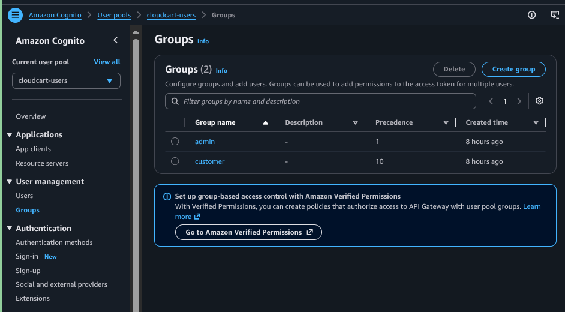

Created a Cognito User Pool (`cloudcart-users`) with email sign-in and two
groups: `admin` and `customer`. A public app client (`cloudcart-web`) with
`ALLOW_ADMIN_USER_PASSWORD_AUTH` enabled lets the CLI mint ID tokens for
testing. The PHP app verifies those tokens against Cognito's JWKS endpoint and
reads the `cognito:groups` claim to decide what each user can do.

# 3. Storage and Data

## 9. S3 buckets

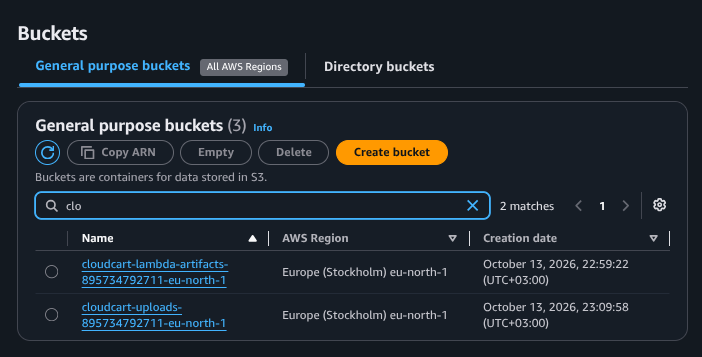
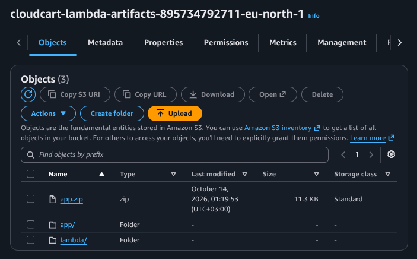

Two buckets with distinct roles:

- **cloudcart-uploads-…**: holds user-uploaded files. An `ObjectCreated:*` event notification triggers the record-writer Lambda on every upload.
- **cloudcart-lambda-artifacts-…** : holds the two deployment zips: the Lambda's Python code and the PHP application bundle. Written by `deploy.sh`, read by EC2 instances at bootstrap and by Lambda at cold start.

Both have Block Public Access fully enabled; nothing in either bucket is
reachable from the internet.

## 10. EFS

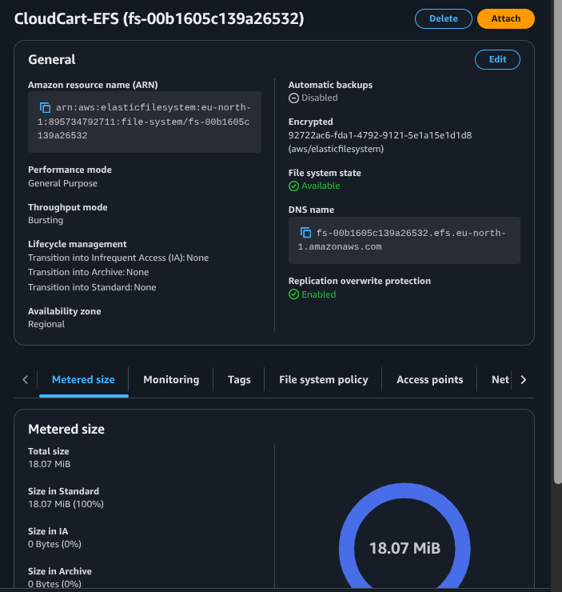

Created a single encrypted EFS file system with mount targets in both private
app subnets. EC2 instances mount it at `/mnt/efs` and serve the PHP app from
`/mnt/efs/app/current` (a symlink to the current release). Because the code
lives on EFS, both instances always serve the same files and a new instance
launched by the Auto Scaling group immediately has the full app.

## 11. RDS

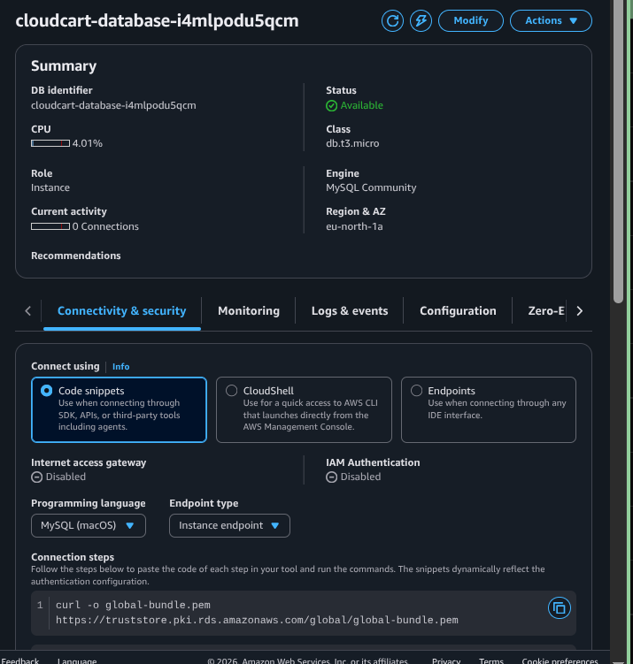

Created a `db.t3.micro` MySQL instance in the private data subnets, not
publicly accessible, attached to `rds-mysql-sg`. It holds all structured data:
`products`, `customers`, `carts`, `cart_items`, `orders`, `order_items`, and
`uploads`. A subnet group spanning both data subnets ensures RDS is redundant
across AZs even though the instance itself is single-AZ.

# Identity, Messaging, and Compute

## 12. IAM roles

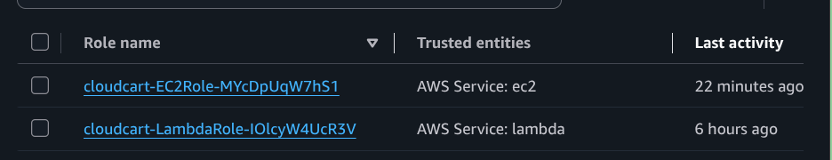

Two roles, each scoped to exactly what its workload needs:

- **cloudcart-ec2-role** : `AmazonSSMManagedInstanceCore` (for session-manager access with no SSH key) plus an inline `AppCodeRead` policy granting `s3:ListBucket` on the artifact bucket and `s3:GetObject` on `app/*` only.
- **cloudcart-lambda-role** : `AWSLambdaVPCAccessExecutionRole` (for CloudWatch Logs and ENI management) plus an inline policy granting `s3:GetObject` on the uploads bucket and `sns:Publish` on one specific topic.

Neither role uses wildcards on resources, and neither can reach the other's
resources. Least privilege, one role per compute identity.

## 13. SNS

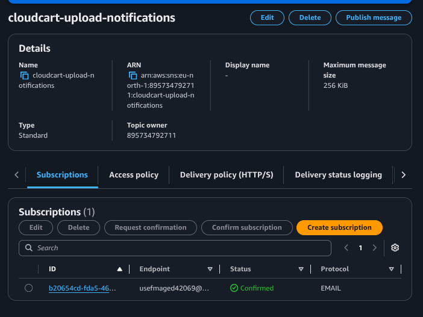

Created the `cloudcart-upload-notifications` topic and subscribed an email
address to it. The record-writer Lambda publishes to this topic after every
upload, which is how the confirmation email reaches the operator. The email
subscription had to be confirmed from the inbox before notifications would
flow.

## 14. Lambda

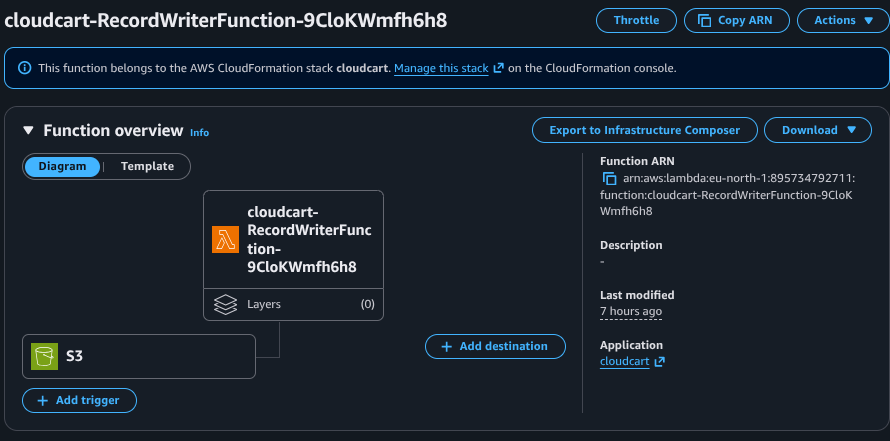
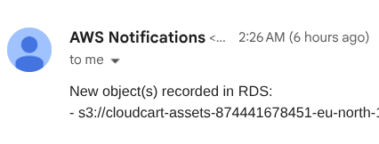

Created `cloudcart-record-writer` on Python 3.12, uploaded its code from the
artifact bucket, and configured it with:

- **VPC attachment** to both private app subnets (so it can reach RDS on a private IP).
- **Environment variables** for the RDS endpoint, credentials, and SNS topic ARN.
- **The S3 trigger** wired from the uploads bucket's event notification.

Every file that lands in the uploads bucket now writes a row into RDS and
publishes to SNS — the entire upload flow runs without a server to manage.

# 5. Load Balancing and Scaling

## 15. Load Balancer

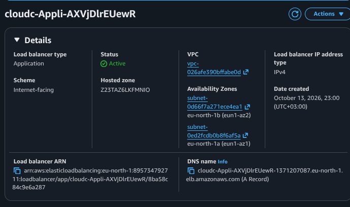

Created an internet-facing Application Load Balancer in both public subnets,
with a listener on port 80 forwarding to `cloudcart-tg`. The target group has
**sticky sessions** enabled (`lb_cookie`, 1 hour) so a user's PHP session
always lands on the same instance while their session file is being read from
EFS.

## 16. Launch Template

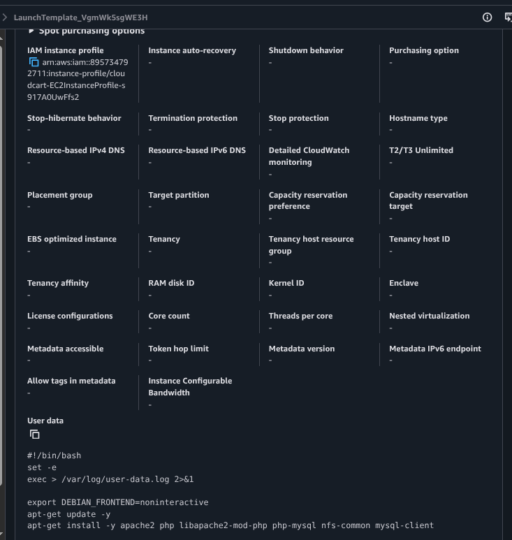

Created `cloudcart-lt` from the Ubuntu 26.04 LTS AMI, `t3.micro`, attached to
`ec2-lab-sg` and `cloudcart-ec2-role`. The **User Data** script is the
bootstrap: it mounts EFS, pulls the app bundle from S3 into a timestamped
release directory, flips the `current` symlink, configures Apache's vhost and
PHP environment, restarts Apache, waits for RDS, and applies the schema. This
is what makes every instance self-sufficient on first boot.

## 17. Auto Scaling Group

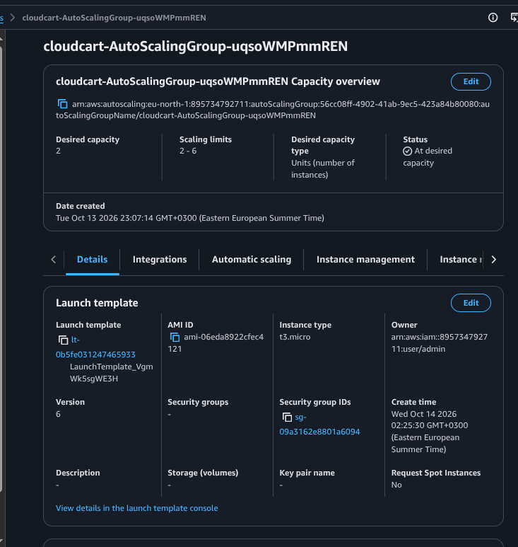
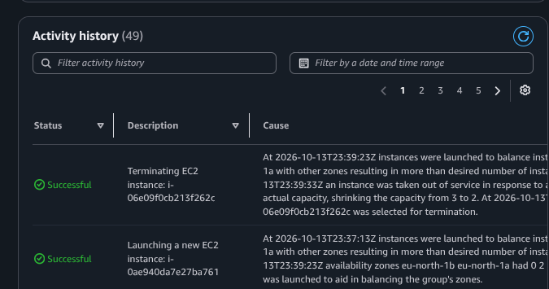

Created `cloudcart-asg` with min 2, desired 2, max 6, spread across the two
private app subnets and attached to the target group. Health checks are ELB
type with a 900 second grace period which is long enough for the user-data bootstrap
to finish before the ASG starts evaluating health. A **target-tracking scaling
policy** keeps average CPU at 50%, adding instances automatically when the
site is busy and removing them when it isn't.

## 18. EC2 instances

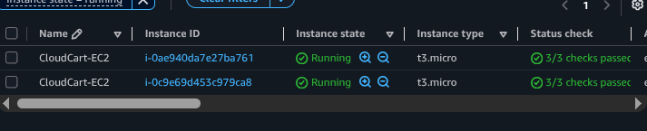

The ASG launched two instances, both tagged `CloudCart-EC2`, both registered
as healthy targets behind the ALB. These are the machines actually serving the
application: Apache reads the PHP files from EFS, PHP connects to RDS for
data, and every request passes through the JWT verification layer in
`auth.php` before rendering a page.

# End-to-end request flow

The whole stack works like so
1. **User** hits the ALB DNS name over HTTP.
2. **ALB** terminates the request, picks a healthy target using the sticky-session cookie, and forwards to an **EC2 instance** in a private subnet.
3. **Apache** reads `index.php` from **EFS** at `/mnt/efs/app/current/`.
4. **PHP** verifies the user's session, and if a token is present, validates it against **Cognito's JWKS**.
5. **PHP** connects to **RDS MySQL** on port 3306 and runs `SELECT * FROM products`.
6. **Apache** renders the HTML and returns it through the ALB to the browser.

And the upload flow, entirely event-driven:

1. A file is written to the **S3 uploads bucket**.
2. **S3** fires an `ObjectCreated:*` event.
3. **Lambda** (running from an ENI in a private app subnet) writes a row into RDS's `uploads` table.
4. **Lambda** publishes to the **SNS topic**.
5. **SNS** delivers an email to the subscribed address.

Every hop between AWS services stays inside the VPC except for Cognito (over
NAT) and SNS delivery (control plane), and no data-store is reachable from the
public internet.